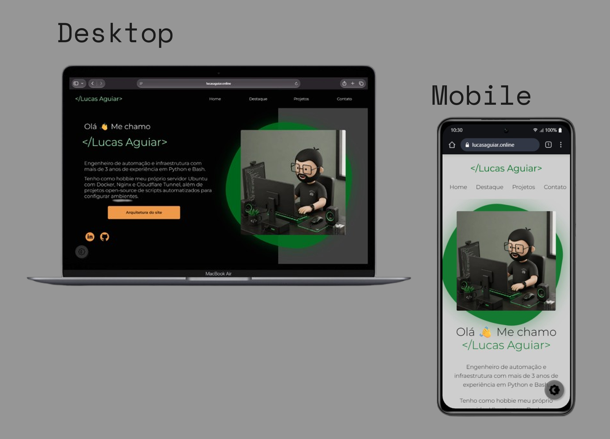
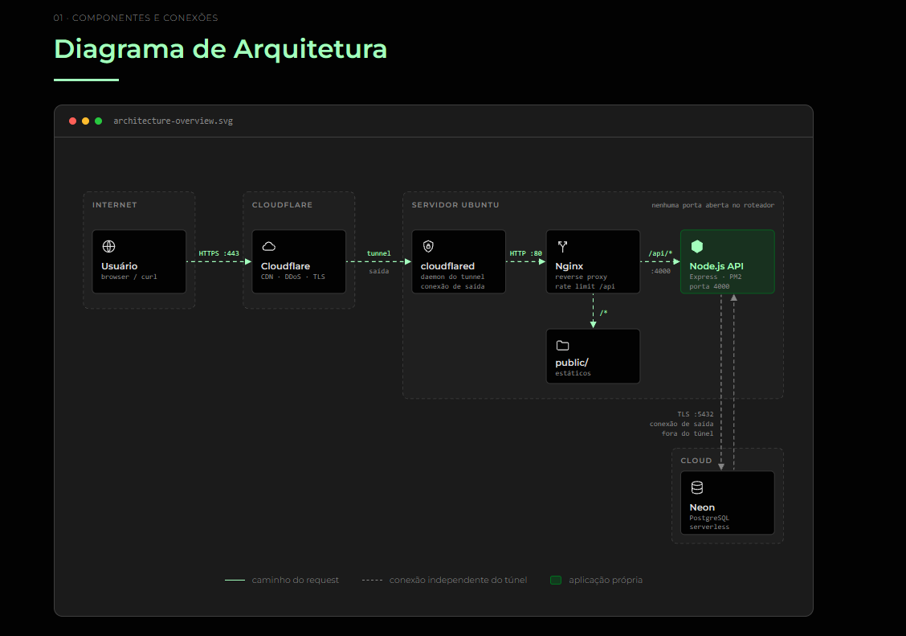

# Portfólio · Lucas Aguiar

Portfólio de um engenheiro de automação e infraestrutura: um site estático, rápido e sem framework, alimentado por uma API própria que roda no meu servidor Ubuntu e publicada na internet por um túnel da Cloudflare.

**Acesse:** [lucasaguiar.online](https://lucasaguiar.online)

<p align="center">
  
</p>

## O que tem no site

- **Projeto em destaque (DocsPro):** um case com resultados reais, com métricas vindas do banco e um contador que acumula a economia gerada e o tempo em produção, segundo a segundo, desde a data de entrada em produção.
- **Projetos principais:** cards com logo, descrição e as tecnologias usadas, sempre com as linguagens primeiro.
- **Outros projetos:** lista enxuta de projetos menores, cada um com descrição curta e link para o repositório.
- **Contato simples:** botão que abre o e-mail (Gmail no desktop, app de e-mail no celular) e opção de copiar o endereço. Não há envio de e-mail no servidor.
- **Tema escuro e claro**, com preferência salva no navegador, e animações de entrada por scroll que respeitam `prefers-reduced-motion`.
- **Página de arquitetura:** diagrama de como o site é servido, em `/assets/screens/architecture.html`.

## Stack

| Camada | Tecnologias |
| --- | --- |
| Front-end | HTML, CSS puro (organizado em `base/`, `components/` e `sections/`) e JavaScript em módulos ES, sem bibliotecas |
| API | Node.js, Express, PM2 |
| Banco | PostgreSQL serverless no [Neon](https://neon.tech) |
| Infra | Ubuntu, Nginx (proxy reverso, cabeçalhos de segurança e rate limit), Cloudflare Tunnel (`cloudflared`) |

## Arquitetura

```
Usuário ──HTTPS──▶ Cloudflare ──túnel──▶ cloudflared ──▶ Nginx ─┬─ /      → public/ (arquivos estáticos)
                                                                 └─ /api/* → Node.js (Express :4000) ──TLS──▶ Neon (PostgreSQL)
```

Nenhuma porta fica aberta no roteador: o `cloudflared` faz uma conexão de saída até a Cloudflare, e o Nginx serve os estáticos e encaminha apenas `/api/*` para a aplicação. O diagrama completo está na própria página de arquitetura do site.

<p align="center">
  
</p>

## Estrutura do repositório

```
backend/
  server.js              # Express: CORS restrito, /api/projetos e /api/health
  controllers/           # Regras de leitura/criação de projetos
  middlewares/apiKey.js  # Protege o POST com chave de administrador
  routes/ · db/          # Rotas e pool de conexão com o Neon
public/
  index.html
  assets/
    css/                 # style.css importa base/, components/ e sections/
    js/                  # main.js e módulos (projetos, odômetro, fade, tema, copiar e-mail)
    images/ · fonts/ · screens/
scripts_sql/             # Migrações e seeds do banco (SQL)
ecosystem.config.js      # Configuração do PM2
```

## API

| Método | Rota | Descrição |
| --- | --- | --- |
| `GET` | `/api/projetos` | Lista os projetos com tier (`spotlight`, `featured` ou `other`), ordem, métricas, logo e tecnologias |
| `POST` | `/api/projetos` | Cria um projeto. Exige o cabeçalho `x-api-key`; fica desativado se `ADMIN_API_KEY` não estiver definida |
| `GET` | `/api/health` | Verificação de saúde (status e uptime) |

## Rodando localmente

Pré-requisitos: Node.js e um banco PostgreSQL (o Neon tem plano gratuito).

```bash
npm install
# crie um arquivo .env com as variáveis abaixo
npm run dev            # API em http://localhost:4000
```

A API não serve o front-end: em produção quem faz isso é o Nginx. Localmente, sirva a pasta `public/` com qualquer servidor estático (por exemplo `npx serve public`) apontando `/api` para a porta 4000, ou use um proxy equivalente ao do Nginx.

### Variáveis de ambiente

| Variável | Descrição |
| --- | --- |
| `PORT` | Porta da API (padrão `4000`) |
| `NODE_ENV` | Em `production`, libera apenas as origens de `CORS_ORIGINS` |
| `CORS_ORIGINS` | Origens permitidas, separadas por vírgula (padrão: o domínio do site) |
| `NEON_HOST`, `NEON_USER`, `NEON_PASSWORD`, `NEON_NAME` | Credenciais do PostgreSQL |
| `ADMIN_API_KEY` | Chave do `POST /api/projetos` (opcional) |

## Banco de dados

Os dados dos projetos ficam em três tabelas: `projects`, `technologies` e `projects_technologies`. As alterações de esquema e de conteúdo estão em `scripts_sql/`, em arquivos **idempotentes**: podem ser executados mais de uma vez sem duplicar dados. Não há ferramenta de migração, então cada arquivo é aplicado manualmente no banco, na ordem em que foi criado (`migracao_tier_neon.sql`, `migracao_projetos_v2_neon.sql`, `migracao_logos_neon.sql`).

## Deploy

```bash
pm2 start ecosystem.config.js   # primeira vez
pm2 restart portfolio-api       # após alterar o backend
```

O front-end não tem etapa de build: basta atualizar os arquivos em `public/`. Como o Nginx e a Cloudflare mantêm cache, as URLs dos CSS e JS levam um `?v=` que deve ser incrementado a cada alteração.

## Contato

- E-mail: aguiarlucas.dev@gmail.com
- [LinkedIn](https://www.linkedin.com/in/lucas-aguiar23/)
- [GitHub](https://github.com/lucasaguiar-la)
